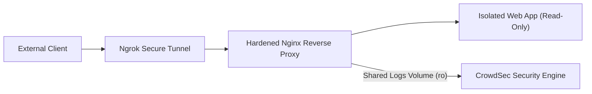

# Docker + CrowdSec + Ngrok Secure Web Stack

A containerized, defense-in-depth web architecture combining a hardened **Nginx** reverse proxy, **CrowdSec** collaborative intrusion detection engine, isolated Docker networks, and secure external routing via **Ngrok**.

## Architecture



## Security Highlights

- **Network Isolation:** Backend `web-app` runs on an `internal: true` Docker bridge with zero direct external exposure.
- **Container Hardening:** `read_only: true` filesystem and `no-new-privileges:true` security options.
- **Hardened Reverse Proxy (`nginx.conf`):**
  - `server_tokens off` and hidden `X-Powered-By`
  - Strict security headers (`CSP`, `X-Frame-Options`, `X-Content-Type-Options`, `Referrer-Policy`, `Permissions-Policy`)
  - Per-IP request rate limiting (`15r/s`) & connection limits
  - Automatic dotfile blocking (`.env`, `.git`)
- **CrowdSec Monitoring (`acquis.yaml`):** Parses Nginx access & error logs in real time with `crowdsecurity/nginx` and `crowdsecurity/http-cve` collections.
- **Zero Open Firewall Ports:** Uses an outbound **Ngrok** tunnel instead of exposing host ports directly.

## Quick Start

```bash
# 1. Configure environment variables
cp .env.example .env
# Edit .env and add your NGROK_AUTHTOKEN

# 2. Launch the stack
docker compose up -d

# 3. Verify health
curl http://localhost:8080/healthz
```

## Useful CrowdSec Commands

```bash
# Inspect active CrowdSec alerts
docker exec secure-stack-crowdsec cscli alerts list

# Check active decisions / bans
docker exec secure-stack-crowdsec cscli decisions list

# View live log parsing metrics
docker exec secure-stack-crowdsec cscli metrics
```

## Author

**Issam Derai** — [LinkedIn](https://www.linkedin.com/in/issam-derai) · [GitHub](https://github.com/issamxx)
